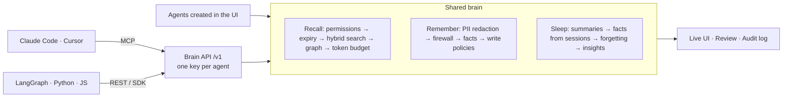

# 🧠 Agent Brain Hub

**English** · [Tiếng Việt](README.vi.md)

[](https://github.com/leluong141996-dev/Agent-Brain-Hub/actions/workflows/ci.yml)
[](https://github.com/leluong141996-dev/Agent-Brain-Hub/releases/latest)
[](LICENSE)


**Governed shared memory for multi-agent systems.** Every agent you run (Claude Code, Cursor, LangGraph nodes, your own bots) reads and writes one memory, under rules you can see and audit: which agent may read what, which value wins when agents disagree, what has expired, and what looks planted. It runs locally in one SQLite file, works without an LLM, and shows you live which agent recalled what, and why.


## The problem

Agents forget what other agents learned. A QA agent finds a bug on Monday; on Thursday a fresh coding session writes the same bug again. A support agent learns the customer's car is in the shop; the travel agent asks again. Giving every agent the same transcript does not fix it: it leaks private data between agents, keeps stale facts, and lets one bad message poison everyone's context.

Agent Brain Hub keeps one memory for all of them, with the rules a shared memory needs: who may read what, which value wins when agents disagree, what has expired, and what was planted.

## Example: a dev team that stops repeating the same bug

Three agents work on one repository. They share one brain, and the memory is about the repository:

```python
qa.remember(customer_id="repo:shop-api", facts=[
    {"relation": "known_pitfall", "value": "parseDate breaks on DST changes; test with Europe/Berlin 2026-03-29 02:30"}])
architect.remember(customer_id="repo:shop-api", facts=[
    {"relation": "convention", "value": "store every timestamp in UTC; convert only in the UI"}])

# Days later, a fresh Coder session is asked to touch the same code:
ctx = coder.recall(customer_id="repo:shop-api", text="Implement parseDate for order timestamps")
```
```text
known pitfall: parseDate breaks on DST changes; test with Europe/Berlin 2026-03-29 02:30   (from QA, 3 days ago)
convention: store every timestamp in UTC; convert only in the UI                          (from Architect, 3 days ago)
```

The Coder never talked to QA. `ctx["promptBlock"]` goes into its system prompt, with who said what and when. Run it: [examples/dev_team.py](examples/dev_team.py).

The same works for customer-facing agents: a repair agent learns the customer's car is in the shop for 3 days, and the travel agent later offers a rental car without asking, while the repair details stay private to the repair agent ([six built-in agents](docs/architecture.md#built-in-agents) show this in the UI).

## Quick start

```bash
docker compose up -d        # → http://localhost:4317 (UI) and http://localhost:4317/v1 (API)
```

No Docker? `npm install && npm start` with Node.js ≥ 22. No configuration is needed; add an LLM later in **Settings**.

Create an agent in the UI (**Agents → Connected**) to get its API key, then call the hub around your own model. In Python, with [sdk/brain_client.py](sdk/brain_client.py) (standard library only):

```python
from brain_client import BrainClient
brain = BrainClient(url="http://localhost:4317", api_key="abk_...")   # one key per agent

ctx = brain.recall(customer_id="user-42", text=user_message)            # what all agents know, as a prompt block
reply = my_llm(system=ctx["promptBlock"], user=user_message)
brain.remember(trace_id=ctx["traceId"], reply=reply)                     # the hub learns from the turn
```

| Your stack | How to connect |
|---|---|
| Claude Code, Claude Desktop, Cursor | MCP server, 6 tools: `claude mcp add agent-brain -e BRAIN_URL=http://localhost:4317 -e BRAIN_API_KEY=abk_... -- node /path/to/mcp/server.mjs` |
| LangGraph | A `recall` node before your model, a `remember` node after it: [examples/langgraph_memory.py](examples/langgraph_memory.py) |
| CrewAI, AutoGen, PydanticAI, plain Python | The two calls above around your model |
| JavaScript / TypeScript | [sdk/brain-client.js](sdk/brain-client.js), the same calls |
| Anything else | REST: `POST /v1/recall`, `POST /v1/remember` ([API reference](docs/connecting.md#brain-api-v1-header-authorization-bearer-agent-key)) |

## Why Agent Brain Hub

- **Governed by design.** Each relation has a scope (private / shared / global), an owner and a write policy; each agent has its own key and read/write permissions. When agents disagree, the policy decides, the losing value stays as history, and a person can undo it. Every read and write goes to an append-only audit log, and permissions are checked on every path an agent can call (recall, profile, the entity graph, correct, forget).
- **Measured on what goes wrong between agents.** Most memory benchmarks score one user's questions. This one scores the failures of a shared memory ([the same four a 2026 study names](https://arxiv.org/html/2606.24535v1): leakage, stale propagation, contradictions, lost provenance) plus planted instructions, in 63 scenarios that run in CI on every change. The leak rate and the poison rate must stay at 0.
- **Defended.** A memory firewall holds values that read like instructions and cuts them from messages before any model reads them. It does not catch a false fact that reads like a true one; nothing that screens text can ([why](https://arxiv.org/pdf/2608.21230)), which is what write policies, trust and provenance are for.
- **Visible.** The UI traces every request live and shows where each memory came from and why others were left out.
- **Light to run.** One SQLite file, no vector or graph database. It works without an LLM (rules and templates, $0 in tokens); add any LLM (Claude, GPT, Gemini, Ollama, vLLM…) for better extraction and summaries.

How it compares with the memory layers people usually reach for (from their own docs, October 2026; corrections welcome):

| | Agent Brain Hub | [Mem0](https://docs.mem0.ai/core-concepts/how-it-works) (open source) | [Letta](https://docs.letta.com/tutorials/shared-memory-blocks) | [Zep / Graphiti](https://help.getzep.com/graphiti/graphiti/quick-start) |
|---|---|---|---|---|
| LLM needed to write memory | **No** (optional) | Yes, for fact extraction (`infer=False` stores raw text) | Yes (agent runtime) | Yes (OpenAI by default) |
| Storage to run | **One SQLite file** | A vector store of your choice | The Letta server and its database | A graph database (Neo4j, FalkorDB, Kuzu, Neptune) |
| Sharing between agents | Per-relation scopes, owners, write policies, audit log | Memories scoped by user / agent / run | Memory blocks attached to several agents | Graphs per user or group |

Where they are stronger today: larger communities and production use, managed cloud offerings, storage that scales past one process (this hub is single-process SQLite; Postgres is on the [roadmap](ROADMAP.md)), and published scores on public benchmarks. With an LLM, Mem0 and Zep build richer memories than rules can. Choose this hub when several agents share one memory and you need to control and see who knows what.

## Features

| | |
|---|---|
| **Governance** | Private / shared / global scopes, per-agent keys and read/write permissions, PII redaction, append-only audit log |
| **Memory over time** | Facts are invalidated, not deleted; `recall(asOf=…)` shows what the brain believed at any moment |
| **Entity graph** | "my car", "the Civic" and "車" are one entity; retrieval follows links up to two hops, never into a private fact |
| **Your own domains** | Define agent specialties (intents, retention, private sessions) over the API or in a JSON file |
| **Open schema and write policies** | Relations beyond the 21 built-in ones; `latest`, `owner`, `trust` or `human` decides between conflicting values |
| **Self-maintaining** | Agents correct and forget facts; sleep learns facts from whole sessions; an LLM proposes how to settle conflicts |
| **Memory firewall** | Instruction-like values are held for review; low-trust agents cannot overwrite others |
| **Customer data** | Export or erase everything about one customer or project, history included |
| **Semantic search** | Optional embedding models (OpenAI, Gemini, Ollama `bge-m3`…) on top of offline lexical matching |
| **Three languages** | English, Vietnamese and Japanese, in the UI and in fact extraction |

Details and screenshots: [docs/features.md](docs/features.md).

## How it works



`recall` returns a prompt block that fits a token budget, and each memory says who wrote it, when, and until when it is valid. `remember` extracts facts from the turn, or takes the facts the agent passes, and settles conflicts by policy. A sleep cycle (idle, memory pressure, or nightly) turns conversations into long-term memories and forgets what has expired. The stages are modelled on brain regions, which is what the live view shows. See [docs/architecture.md](docs/architecture.md).

## Benchmark

`npm run bench` runs 63 multi-agent scenarios offline in about a second (English, Vietnamese, Japanese), and CI fails any change that makes a quality metric worse.

| v0.8.4 | Offline (hashing) | With `bge-m3` embeddings | With a local LLM (`qwen3:4b`) |
|---|---|---|---|
| Scenario pass rate | 98.4% | 98.4% | 95.4% |
| Leak rate (private data reaching the wrong agent) | **0%** | **0%** | **0%** |
| Poison rate (planted instructions reaching an agent) | **0%** | **0%** | **0%** |
| Multi-hop questions | 100% (26.7% without the graph) | 93.3% | 100% |
| Recall latency (p50) | 0.5 ms | 104 ms | 0.8 ms |

These are our own scenarios, so they compare versions of this project rather than products. On the public [LongMemEval-S](https://huggingface.co/datasets/xiaowu0162/longmemeval-cleaned) retrieval task, the session holding the answer is in the top 10 for 71.5% of questions with offline hashing; answer accuracy is not measured yet. Methods, the LLM run's caveats and how to add a scenario: [bench/README.md](bench/README.md).

## Security

- Without `BRAIN_ADMIN_TOKEN`, the admin UI and `/api/*` are open to anyone who can reach the port. Set it, and put the hub behind HTTPS, outside your own machine.
- Agents use `/v1/*` with their own key (stored as a hash, rotatable), limited by that agent's permissions.
- All memory is in `data/brain.db`, LLM settings and keys in `data/settings.json`. Don't commit `data/`.

More in [docs/configuration.md](docs/configuration.md): LLM providers, embeddings, storage, backups, environment variables.

## Limits

- One server process (SQLite with an in-memory cache); PostgreSQL + pgvector is planned for v0.9.
- Without an LLM, fact extraction covers the built-in relations and simple patterns only.
- The memory firewall matches patterns: a paraphrased instruction can get through.
- The benchmark scenarios are written by this project.

The full list, and what comes next: [ROADMAP.md](ROADMAP.md).

## Contributing

Docs, translations, scenarios and code are welcome. Start with [CONTRIBUTING.md](CONTRIBUTING.md) and the [`good first issue`](https://github.com/leluong141996-dev/Agent-Brain-Hub/labels/good%20first%20issue) label; questions go to [Discussions](https://github.com/leluong141996-dev/Agent-Brain-Hub/discussions). Release history: [CHANGELOG.md](CHANGELOG.md).

License: [MIT](LICENSE).
