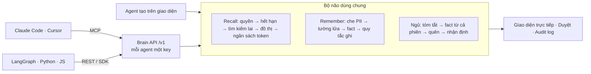

# 🧠 Agent Brain Hub

[English](README.md) · **Tiếng Việt**

[](https://github.com/leluong141996-dev/Agent-Brain-Hub/actions/workflows/ci.yml)
[](https://github.com/leluong141996-dev/Agent-Brain-Hub/releases/latest)
[](LICENSE)


**Bộ nhớ dùng chung cho hệ thống nhiều agent.** Mọi agent bạn chạy (Claude Code, Cursor, node LangGraph, bot của riêng bạn) đọc và ghi vào một bộ nhớ, nên điều một agent học được thì các agent khác dùng được, mà không agent nào thấy hết mọi thứ. Chạy trên máy bằng một file SQLite, không cần LLM, và cho bạn xem trực tiếp agent nào đã nhớ ra điều gì, vì sao.


## Vấn đề

Agent quên những gì agent khác đã học. Thứ Hai agent QA tìm ra một lỗi; thứ Năm một phiên viết code mới lại viết đúng lỗi đó. Agent hỗ trợ biết xe của khách đang sửa; agent du lịch lại hỏi lại. Đưa cho mọi agent cùng một bản ghi hội thoại không giải quyết được: dữ liệu riêng tư rò sang agent khác, thông tin cũ vẫn bị dùng, và một tin nhắn độc có thể đầu độc ngữ cảnh của tất cả.

Agent Brain Hub giữ một bộ nhớ cho tất cả, kèm các quy tắc mà bộ nhớ dùng chung cần có: ai được đọc gì, giá trị nào thắng khi các agent bất đồng, cái gì đã hết hạn, và cái gì bị cài vào.

## Ví dụ: một nhóm dev không lặp lại cùng một lỗi

Ba agent cùng làm trên một repository. Chúng dùng chung một bộ não, và bộ nhớ nói về repository đó:

```python
qa.remember(customer_id="repo:shop-api", facts=[
    {"relation": "known_pitfall", "value": "parseDate breaks on DST changes; test with Europe/Berlin 2026-03-29 02:30"}])
architect.remember(customer_id="repo:shop-api", facts=[
    {"relation": "convention", "value": "store every timestamp in UTC; convert only in the UI"}])

# Vài ngày sau, một phiên Coder mới được giao sửa đúng đoạn code đó:
ctx = coder.recall(customer_id="repo:shop-api", text="Implement parseDate for order timestamps")
```
```text
known pitfall: parseDate breaks on DST changes; test with Europe/Berlin 2026-03-29 02:30   (from QA, 3 days ago)
convention: store every timestamp in UTC; convert only in the UI                          (from Architect, 3 days ago)
```

Coder chưa từng nói chuyện với QA. `ctx["promptBlock"]` được đưa vào system prompt, kèm ai nói gì và khi nào. Chạy thử: [examples/dev_team.py](examples/dev_team.py).

Agent làm việc với khách hàng cũng vậy: agent sửa chữa biết xe của khách nằm xưởng 3 ngày, sau đó agent du lịch chủ động gợi ý thuê xe mà không hỏi lại, còn chi tiết sửa chữa vẫn là thông tin riêng của agent sửa chữa ([sáu agent dựng sẵn](docs/architecture.md#built-in-agents) minh hoạ điều này trên giao diện).

## Bắt đầu nhanh

```bash
docker compose up -d        # → http://localhost:4317 (giao diện) và http://localhost:4317/v1 (API)
```

Không có Docker? Dùng `npm install && npm start` với Node.js ≥ 22. Không cần cấu hình gì; muốn dùng LLM thì thêm sau trong **Cài đặt**.

Tạo một agent trên giao diện (**Agents → Connected**) để lấy API key, rồi gọi hub quanh model của bạn. Với Python, dùng [sdk/brain_client.py](sdk/brain_client.py) (chỉ thư viện chuẩn):

```python
from brain_client import BrainClient
brain = BrainClient(url="http://localhost:4317", api_key="abk_...")   # mỗi agent một key

ctx = brain.recall(customer_id="user-42", text=user_message)            # mọi agent biết gì, dưới dạng prompt block
reply = my_llm(system=ctx["promptBlock"], user=user_message)
brain.remember(trace_id=ctx["traceId"], reply=reply)                     # hub học từ lượt hội thoại
```

| Bạn dùng | Cách kết nối |
|---|---|
| Claude Code, Claude Desktop, Cursor | MCP server, 6 tool: `claude mcp add agent-brain -e BRAIN_URL=http://localhost:4317 -e BRAIN_API_KEY=abk_... -- node /path/to/mcp/server.mjs` |
| LangGraph | Một node `recall` trước model, một node `remember` sau model: [examples/langgraph_memory.py](examples/langgraph_memory.py) |
| CrewAI, AutoGen, PydanticAI, Python thuần | Hai lệnh gọi ở trên, quanh model của bạn |
| JavaScript / TypeScript | [sdk/brain-client.js](sdk/brain-client.js), cùng các lệnh gọi đó |
| Thứ khác | REST: `POST /v1/recall`, `POST /v1/remember` ([tài liệu API](docs/connecting.md#brain-api-v1-header-authorization-bearer-agent-key), tiếng Anh) |

## Vì sao chọn Agent Brain Hub

- **Không cần LLM để ghi nhớ.** Luật và template trích fact, xử lý mâu thuẫn, hết hạn và quyền riêng tư ngay khi offline, tốn 0 đồng token. Thêm LLM bất kỳ (Claude, GPT, Gemini, Ollama, vLLM…) để trích fact và tóm tắt tốt hơn.
- **Một file SQLite.** Không cần vector database, graph database hay Postgres.
- **Làm cho nhiều agent.** Mỗi quan hệ có phạm vi (private / shared / global), chủ sở hữu và quy tắc ghi. Khi các agent bất đồng, quy tắc quyết định và người duyệt có thể hoàn tác. Mọi lượt đọc và ghi vào audit log chỉ ghi thêm.
- **Có phòng thủ.** Tường lửa bộ nhớ giữ lại các giá trị đọc như câu lệnh ("ignore all previous instructions…") và cắt chúng khỏi tin nhắn trước khi bất kỳ model nào đọc.
- **Nhìn thấy được.** Giao diện vẽ trực tiếp từng yêu cầu đi qua các giai đoạn của bộ não và cho biết mỗi ký ức đến từ đâu.
- **Có đo lường.** 63 kịch bản nhiều agent chạy trong CI ở mỗi thay đổi; tỷ lệ rò rỉ và tỷ lệ nhiễm độc phải giữ ở 0.

So với các lớp bộ nhớ hay được dùng (theo tài liệu của chính họ, tháng 10/2026; nếu sai xin góp ý):

| | Agent Brain Hub | [Mem0](https://docs.mem0.ai/core-concepts/how-it-works) (mã nguồn mở) | [Letta](https://docs.letta.com/tutorials/shared-memory-blocks) | [Zep / Graphiti](https://help.getzep.com/graphiti/graphiti/quick-start) |
|---|---|---|---|---|
| Cần LLM để ghi nhớ | **Không** (tuỳ chọn) | Có, để trích fact (`infer=False` lưu nguyên văn) | Có (runtime cho agent) | Có (mặc định OpenAI) |
| Hạ tầng lưu trữ | **Một file SQLite** | Vector store tuỳ chọn | Server Letta và database của nó | Graph database (Neo4j, FalkorDB, Kuzu, Neptune) |
| Chia sẻ giữa các agent | Phạm vi theo quan hệ, chủ sở hữu, quy tắc ghi, audit log | Ký ức gắn theo user / agent / run | Memory block gắn vào nhiều agent | Đồ thị theo user hoặc group |

Họ mạnh hơn ở: cộng đồng và mức độ dùng thực tế lớn hơn, có bản cloud, hạ tầng mở rộng vượt một tiến trình (hub này là SQLite một tiến trình; Postgres nằm trong [ROADMAP](ROADMAP.md)), và có điểm công bố trên benchmark công khai. Khi có LLM, Mem0 và Zep dựng ký ức phong phú hơn luật. Hãy chọn hub này khi nhiều agent dùng chung một bộ nhớ và bạn cần kiểm soát, nhìn thấy ai biết gì.

## Tính năng

| | |
|---|---|
| **Quản trị** | Phạm vi private / shared / global, key và quyền đọc/ghi theo agent, che PII, audit log chỉ ghi thêm |
| **Bộ nhớ theo thời gian** | Fact bị vô hiệu chứ không bị xoá; `recall(asOf=…)` cho biết bộ não đã tin gì vào bất kỳ lúc nào |
| **Đồ thị thực thể** | "xe của tôi", "chiếc Civic" và "車" là một thực thể; truy xuất đi theo liên kết tối đa hai bước, không bao giờ vào fact private |
| **Schema mở và quy tắc ghi** | Quan hệ ngoài 21 loại có sẵn; `latest`, `owner`, `trust` hoặc `human` quyết định giữa các giá trị mâu thuẫn |
| **Tự bảo trì** | Agent sửa và xoá fact; giấc ngủ học fact từ cả phiên; LLM đề xuất cách giải mâu thuẫn |
| **Tường lửa bộ nhớ** | Giá trị giống câu lệnh bị giữ lại chờ duyệt; agent có độ tin cậy thấp không ghi đè được agent khác |
| **Dữ liệu khách hàng** | Xuất hoặc xoá mọi thứ về một khách hàng hay dự án, kể cả lịch sử |
| **Tìm kiếm ngữ nghĩa** | Model embedding tuỳ chọn (OpenAI, Gemini, Ollama `bge-m3`…) trên nền so khớp từ vựng offline |
| **Ba ngôn ngữ** | Tiếng Anh, tiếng Việt và tiếng Nhật, cả trên giao diện lẫn khi trích fact |

Chi tiết và ảnh chụp: [docs/features.md](docs/features.md) (tiếng Anh).

## Cách hoạt động



`recall` trả về một prompt block vừa ngân sách token, và mỗi ký ức ghi rõ ai viết, khi nào, còn hiệu lực tới khi nào. `remember` trích fact từ lượt hội thoại, hoặc nhận fact do agent gửi, rồi giải mâu thuẫn theo quy tắc. Chu kỳ ngủ (khi rảnh, khi bộ nhớ đầy, hoặc hằng đêm) biến hội thoại thành ký ức dài hạn và quên những gì đã hết hạn. Các giai đoạn được mô phỏng theo các vùng não, và đó là thứ giao diện trực tiếp hiển thị. Xem [docs/architecture.md](docs/architecture.md) (tiếng Anh).

## Benchmark

`npm run bench` chạy 63 kịch bản nhiều agent offline trong khoảng một giây (tiếng Anh, Việt, Nhật), và CI chặn mọi thay đổi làm tụt một chỉ số chất lượng.

| v0.8.4 | Offline (hashing) | Với embedding `bge-m3` | Với LLM trên máy (`qwen3:4b`) |
|---|---|---|---|
| Tỷ lệ kịch bản đạt | 98,4% | 98,4% | 95,4% |
| Tỷ lệ rò rỉ (dữ liệu riêng tới sai agent) | **0%** | **0%** | **0%** |
| Tỷ lệ nhiễm độc (chỉ dẫn bị cài tới được agent) | **0%** | **0%** | **0%** |
| Câu hỏi nhiều bước | 100% (26,7% khi tắt đồ thị) | 93,3% | 100% |
| Độ trễ recall (p50) | 0,5 ms | 104 ms | 0,8 ms |

Đây là kịch bản do dự án tự viết, nên dùng để so các phiên bản của dự án, không phải để so sản phẩm. Trên bài truy xuất công khai [LongMemEval-S](https://huggingface.co/datasets/xiaowu0162/longmemeval-cleaned), phiên chứa câu trả lời nằm trong top 10 ở 71,5% câu hỏi với hashing offline; độ chính xác của câu trả lời chưa được đo. Phương pháp, các lưu ý của lần chạy với LLM và cách thêm kịch bản: [bench/README.md](bench/README.md) (tiếng Anh).

## Bảo mật

- Không đặt `BRAIN_ADMIN_TOKEN` thì giao diện quản trị và `/api/*` mở cho bất kỳ ai truy cập được cổng. Hãy đặt nó, và để hub sau HTTPS khi chạy ngoài máy của bạn.
- Agent dùng `/v1/*` bằng key riêng (lưu dạng hash, đổi được), trong giới hạn quyền của agent đó.
- Toàn bộ bộ nhớ nằm trong `data/brain.db`, cấu hình LLM và key trong `data/settings.json`. Đừng commit thư mục `data/`.

Thêm trong [docs/configuration.md](docs/configuration.md) (tiếng Anh): nhà cung cấp LLM, embedding, lưu trữ, sao lưu, biến môi trường.

## Giới hạn

- Một tiến trình server (SQLite với cache trong bộ nhớ); PostgreSQL + pgvector dự kiến ở v0.9.
- Không có LLM thì việc trích fact chỉ phủ các quan hệ có sẵn và các mẫu đơn giản.
- Tường lửa bộ nhớ khớp theo mẫu: chỉ dẫn được diễn đạt lại có thể lọt qua.
- Các kịch bản benchmark do chính dự án viết.

Danh sách đầy đủ và các bước tiếp theo: [ROADMAP.md](ROADMAP.md).

## Đóng góp

Rất hoan nghênh đóng góp về tài liệu, bản dịch, kịch bản và code. Bắt đầu với [CONTRIBUTING.md](CONTRIBUTING.md) và nhãn [`good first issue`](https://github.com/leluong141996-dev/Agent-Brain-Hub/labels/good%20first%20issue); câu hỏi gửi vào [Discussions](https://github.com/leluong141996-dev/Agent-Brain-Hub/discussions). Lịch sử phát hành: [CHANGELOG.md](CHANGELOG.md).

Giấy phép: [MIT](LICENSE).
