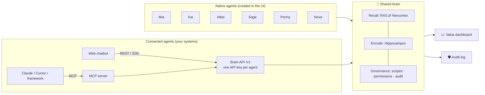

[← README](../README.md)

# Architecture

## Overview

The memory is organized like a human brain: 13 regions and a wake/sleep cycle, following the CoALA framework (Cognitive Architectures for Language Agents). The design draws on the *Vita Cognitive Memory Architecture* document.

| Screen | What it's for |
|---|---|
| 🧠 **Live brain** | Watch the signal travel through the 13 brain regions for every message, including messages from external agents over the API. Chat with native agents, see which store each piece of information came from, and inspect working, semantic, episodic and procedural memory. |
| 🤖 **Agents** | Create native or connected agents, toggle read/write permissions, issue and rotate API keys, and copy ready-made integration code (cURL, JS, Python, MCP). |
| 📈 **Business value** | Questions customers didn't have to answer again, cross-agent knowledge reuse, handoffs, suggestion acceptance rate, learned skills, blocked leaks, and a matrix of knowledge flowing between agents. |
| 🛡️ **Audit log** | Every read, write, block and API call: who read whose memory, for which customer, and when. Filter by operation and search. |
| ⚙️ **Settings** | Pick an LLM provider (Claude, GPT, Gemini, DeepSeek, local models…), fetch the model list, test the connection and apply it immediately. See storage details (SQLite file, size, row counts). |

The left sidebar holds navigation, model status, the **language** picker and the **light / dark / system** theme switch. The Live brain screen has a **customer** picker (the brain keeps a separate memory per customer). The UI uses color tokens for both themes, one consistent SVG icon set, and works down to phone width.

## Memory architecture (13 brain regions)

| Region | Service | File |
|---|---|---|
| Thalamus | Context gateway: sessions, agent-switch detection, routing | [thalamus.js](../server/brain/thalamus.js) |
| Brainstem | Guardrails: PII, crisis reflex, output compliance | [brainstem.js](../server/brain/brainstem.js) |
| Amygdala | Salience: sentiment, urgency, churn risk, VIP → priority | [amygdala.js](../server/brain/amygdala.js) |
| Corpus callosum | Handoff between agents, write delegation | [corpusCallosum.js](../server/brain/corpusCallosum.js) |
| Prefrontal cortex | Working memory + executive loop, LLM calls | [prefrontal.js](../server/brain/prefrontal.js), [respond.js](../server/brain/respond.js) |
| Cerebellum | Playbooks, versioned skill promotion | [cerebellum.js](../server/brain/cerebellum.js) |
| RAS | Retrieval: permissions → TTL → hybrid scoring → re-rank → token budget | [ras.js](../server/brain/ras.js) |
| Neocortex | Episodic + semantic memory, hot/warm/cold tiers, contradictions, scoping | [neocortex.js](../server/brain/neocortex.js), [ontology.js](../server/brain/ontology.js) |
| Basal ganglia | Next best action (Thompson-sampling bandit), learns from feedback | [basalGanglia.js](../server/brain/basalGanglia.js) |
| Hippocampus | Fact extraction (rules + LLM + explicit facts from the API), consolidation | [hippocampus.js](../server/brain/hippocampus.js) |
| Synaptic pruning | Forgetting: TTL, replacement, decay | [forgetting.js](../server/brain/forgetting.js) |
| Default mode network | Reflection: insights, skill review | [dmn.js](../server/brain/dmn.js) |
| Audit | Who read or wrote what | [audit.js](../server/brain/audit.js) |

The orchestrator [server/brain/index.js](../server/brain/index.js) has three entry points that share the `perceive` phase (Thalamus → … → Basal ganglia):

- `think()`: native agents; the brain generates the reply.
- `recall()`: a connected agent fetches its context package.
- `remember()`: a connected agent sends the turn back so the brain can learn.

The sleep loop (`sleep()`) runs Hippocampus → Forgetting → DMN → Cerebellum.

### When the brain sleeps

Besides the **Run sleep cycle** button, the brain sleeps on its own ([sleepScheduler.js](../server/brain/sleepScheduler.js)):

| Trigger | When | Default |
|---|---|---|
| **Idle** | A customer has been quiet long enough for the session to count as over, and turns are waiting | 30 min (the same gap that starts a new session) |
| **Pressure** | This many turns are waiting. Working memory keeps only the last 40, so without this, older turns would be dropped before reaching long-term memory | 24 turns |
| **Nightly** | Once a day, for every customer active since the previous night | 03:00 server time |

Change them in **Settings → Sleep cycle**, which also lists who is waiting to sleep and the recent runs with their trigger. Automatic runs show up live in the brain view like any other trace. Manual and automatic runs share one queue, so they never overlap. Environment variables set the defaults (`BRAIN_SLEEP_AUTO`, `BRAIN_SLEEP_IDLE_MINUTES`, `BRAIN_SLEEP_MAX_PENDING`, `BRAIN_SLEEP_NIGHTLY_AT`, see [.env.example](../.env.example)). The Docker image runs in UTC: set `TZ`, for example `TZ=Asia/Ho_Chi_Minh`, so "03:00" means your night.

## Built-in agents

| Agent | Domain | Memory kept for | Scope |
|---|---|---|---|
| **Mia** | Personal assistant: profile, family, schedule, preferences | forever | shared |
| **Kai** | Repair & maintenance: cars, laptops, phones, home appliances | 90 days | shared |
| **Atlas** | Travel & transport | 1 year | shared |
| **Sage** | Health | 10 years | 🔒 private |
| **Penny** | Personal finance (the budget is deliberately shared, income is not) | 5 years | 🔒 private |
| **Nova** | Shopping & orders | 180 days | shared |

A seventh domain, **Software engineering**, has no built-in agent: create your own (architect, coder, QA…) as connected agents. Its relations are `known_pitfall` and `convention` (shared, kept for a year), and the "customer" is the project or repository.

## Value dashboard: how the metrics are measured

| Metric | Definition (computed from the audit log) |
|---|---|
| **Questions customers didn't have to answer again** | Number of distinct facts that agent B read from memories written by agent A. Time saved is estimated at 20 seconds per question; the UI shows this assumption. |
| Cross-agent knowledge reuse | Total reads of memories written by another agent |
| Seamless handoffs | Times a customer switched agents and the context went along |
| Suggestion acceptance rate | 👍 / (👍 + 👎) for the next best action |
| Learned skills | Skills promoted by the cerebellum, with the number of runs done from a playbook |
| Blocked leaks | Private or unauthorized reads blocked by the RAS |
| Knowledge flow | Writer agent × reader agent matrix. Off-diagonal cells are shared knowledge. |
